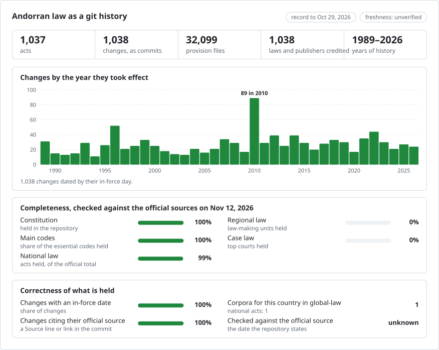

# Andorra: law history in git

**English** · **[O llegiu-lo en català](README.md)**

<picture>
<source media="(prefers-color-scheme: dark)" srcset="data/effort-dark.svg">

</picture>

The law of Andorra as a git history: one file per article, one commit per law on the day it entered into force, and the law itself as the commit's author. Each law is its text as enacted: the official gazette (BOPA) publishes no consolidated versions, so later amendments are not applied here, and the changes later laws state are listed instead. `git log` gives the day each law entered into force; picking a date tells whether a law was in force that day and gives its text as enacted.

Part of [lexifina/global-law](https://github.com/lexifina/global-law), one git history for every country's law: this is Andorra's national law, which global-law reads at `andorra/national/acts/`.

**What is in it now:** the Constitution of 1993 and 1,040 laws of the Consell General, published in the Butlletí Oficial del Principat d'Andorra (BOPA) from 1989-01-29 to 2026-10-28: 1,037 laws in force by 2026-10-29 on `main`, and 3 that enter into force later on the branch `future`; 4,048 changes stated by later laws, listed in [`data/amendments.csv`](data/amendments.csv); and 24 corrections of errata, listed in [`data/corrections.csv`](data/corrections.csv). [`laws.csv`](laws.csv) lists every law, with its bulletin and the days it was published and entered into force.

Each law has its own folder, `lleis/<year>-<number>/` (`lleis/2018-031/` is the Llei 31/2018, del 6 de desembre, de relacions laborals, the Labour Relations Law); laws from before 2003, when numbering began, and a few others are in `lleis/<publication date>-<BOPA document id>/`, and the Constitution is in [`constitucio/`](constitucio/). A folder holds one file per article, disposition or annex, with `preamble.md`, `signatures.md` and `index.txt` (the files in the law's order).

The text is in Catalan, the official language, as the BOPA publishes it. An English translation is not part of this record.

## Questions as git commands

| Question | Command |
| --- | --- |
| Every change later laws state to the Labour Relations Law | `grep ',lleis/2018-031,' data/amendments.csv` |
| Which law wrote each line of Article 1? | `git blame lleis/2018-031/article-001.md` |
| The day the Labour Relations Law entered into force, and why that day | `git log --format="%h %(trailers:key=In-force,valueonly,separator=) %(trailers:key=In-force-basis,valueonly,separator=)" -- lleis/2018-031` |
| Article 1 as enacted, if in force on 1 January 2026 | `python tools/in_force_on.py 2026-01-01 lleis/2018-031 article-001` |

**Outside git**, we also host this record publicly, for free:

- **[Ask Claude about Andorran law](https://global-law.lexifina.com/v1/try_claude?country=andorra)**: opens Claude with a first question ready.
- **[Ask ChatGPT](https://global-law.lexifina.com/v1/try_chatgpt?country=andorra)**: the same question in ChatGPT.
- **[Search Andorran law on our site](https://lexifina.com/law?country=andorra&q=vacances+anuals)**: a search for "vacances anuals", with each provision's text and its versions, no account needed.
- **[Developer REST API](https://global-law.lexifina.com/v1/search_law?query=vacances+anuals&jurisdiction=andorra)**: the same search as JSON, with no key. See the [documentation here](https://lexifina.com/api/global-law).

Both assistants read the record through the free Global law connector (MCP, `https://global-law.lexifina.com/mcp`); the first time, the chat gives you the link that adds it. Ask in Catalan or in English.

**Host it yourself easily.** All it takes is git and Python, and the tools run on your machine:

```sh
git clone --depth 1 https://github.com/lexifina/global-law && cd global-law
python3 tools/countries.py add andorra/national/acts
python3 tools/law.py show 2026-01-01 andorra/national/acts/lleis/2018-031/article-001.md
```

Opened in Claude Code, Cursor, VS Code or Codex, the clone also starts a local MCP server with the same tools ([MCP.md](https://github.com/lexifina/global-law/blob/main/MCP.md)).

## Dates

Each commit is dated at noon, Europe/Andorra, on the day the law entered into force, and carries it in its `In-force:` trailer; `In-force-basis:` says where the day comes from. Of the 1,041 texts:

- 957 say when they enter into force; the day is counted from the BOPA publication day (the `Published:` trailer), and the commit message quotes the sentence;
- 71 say nothing, and are dated fifteen days after publication, the general rule of the Codi de l'Administració of 29 March 1989, article 9;
- 13 published before that Code are dated by their publication day.

A provision that enters into force on a different day from the rest of its law carries its law's day. Each commit is credited to the law itself (`Llei 31/2018 <llei-2018-31@bopa-ad.invalid>`; the addresses cannot exist); an amending law is a commit of its own text, in its own folder, and is credited with no line of the law it amends.

## How it is checked

- The letters and digits of every law's files, in order, equal those of the BOPA document it came from, checked by `tools/build/check_words.py`, which does not use the build's parser.
- Each commit names its BOPA document and that document's sha256 (`Source:`, `Source-sha256:`, all in [`data/source-sha256.tsv`](data/source-sha256.tsv)); two builds from the same documents give the same commit hashes ([`REPRODUCE.md`](REPRODUCE.md)).
- `tools/in_force_on.py` gives the right answer for sample articles at several dates.
- Every commit's trailers parse; there are no merges, no dates that go backwards and none after the build date on `main`.
- [vulnerabilities/](vulnerabilities/README.en.md): possible drafting mistakes in Andorran law, found by global-law's detectors and checked by hand.

## What it does not show

- **Any law as amended.** The changes later laws state are rows of `data/amendments.csv`, extracted automatically from sentences such as "Es modifica l'article 25 ..."; the extraction is not complete and not checked by hand.
- **Corrections of errata** (24 documents): listed, not applied.
- **Other legislation:** decrees, regulations and other acts of the Government, and the ordinances of the parishes (comuns).
- **Images** and the bulletin's page layout.

## Sources

| Source | Kind | Past versions | Notes |
| --- | --- | --- | --- |
| [Butlletí Oficial del Principat d'Andorra](https://www.bopa.ad) | Official gazette: the Constitution and the laws of the Consell General | no, each law once, as enacted | 1,065 documents under the themes "Lleis" and "Constitució", retrieved 2026-10-29; 24 of them are corrections of errata ([`SOURCES.md`](SOURCES.md)) |

## Licence

See [`LICENSE`](LICENSE). Official texts are not protected by copyright in Andorra (Llei sobre drets d'autor i drets veïns, del 10 de juny de 1999, article 4(2)), and the BOPA's legal notice allows reuse on the conditions quoted in `LICENSE`, one of which is that nothing suggests the BOPA Service takes part in, sponsors or supports it: this repository is not made, sponsored or endorsed by the Servei del Butlletí Oficial del Principat d'Andorra. Lexifina's own contributions are CC0 1.0.

No AI model wrote or changed legal text, and none runs when the repository is built or checked; the scripts were written by an AI model (see [`REPRODUCE.md`](REPRODUCE.md)).

## More

From [lexifina/global-law](https://github.com/lexifina/global-law):

- [FEATURES.md](https://github.com/lexifina/global-law/blob/main/FEATURES.md): every feature, and what every corpus must support (`git blame`, `law.py`, the MCP tools)
- [FAQ.md](https://github.com/lexifina/global-law/blob/main/FAQ.md): questions and answers · [CONTRIBUTING.md](https://github.com/lexifina/global-law/blob/main/CONTRIBUTING.md): proposing changes · [MCP.md](https://github.com/lexifina/global-law/blob/main/MCP.md): the MCP server · [REPRODUCE.md](https://github.com/lexifina/global-law/blob/main/REPRODUCE.md): how it was built · [CHANGELOG.md](https://github.com/lexifina/global-law/blob/main/CHANGELOG.md)
- [FRESHNESS.md](https://github.com/lexifina/global-law/blob/main/FRESHNESS.md): how current each corpus is · [Monitoring](https://github.com/lexifina/global-law/tree/main/monitoring): whether updates are running · [WATCHING.md](https://github.com/lexifina/global-law/blob/main/WATCHING.md): how each official source is watched for changes
- [performance/](https://github.com/lexifina/global-law/tree/main/performance): how fast the tools are, measured
- [visualisations/](https://github.com/lexifina/global-law/tree/main/visualisations): charts and bridges across the world's law
- [Vulnerabilities](https://github.com/lexifina/global-law/tree/main/vulnerabilities): mistakes in legislation as published
