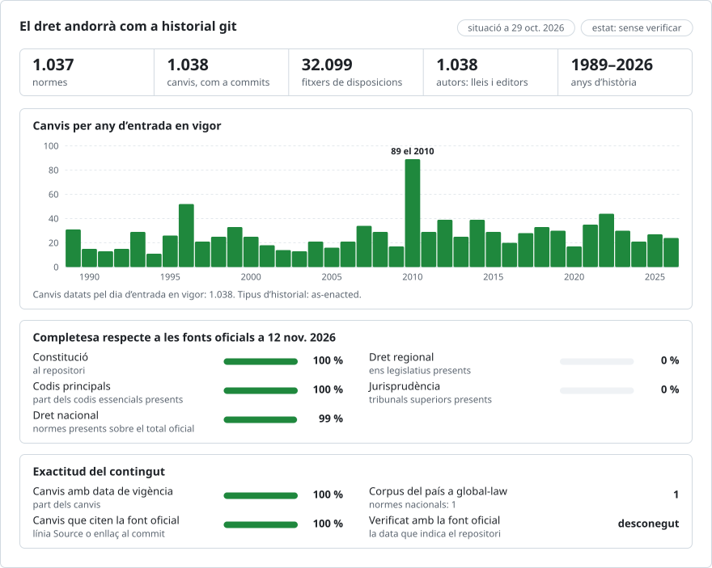

# Andorra: història del dret en git

**Català** · **[Or read it in English](README.en.md)**

<picture>
<source media="(prefers-color-scheme: dark)" srcset="data/ca/effort-dark.svg">

</picture>

El dret d’Andorra com a història git: un fitxer per article, un commit per llei el dia que va entrar en vigor, i la mateixa llei com a autora del commit. Cada llei és el seu text tal com es va aprovar: el butlletí oficial (BOPA) no publica versions consolidades, de manera que aquí no s’hi apliquen les modificacions posteriors, sinó que es recullen a part els canvis que declaren les lleis posteriors. `git log` dona el dia que cada llei va entrar en vigor; triar una data indica si una llei era en vigor aquell dia i en dona el text tal com es va aprovar.

Forma part de [lexifina/global-law](https://github.com/lexifina/global-law), una sola història git per al dret de tots els països: aquest és el dret nacional d’Andorra, que global-law llegeix a `andorra/national/acts/`.

**Què conté ara:** la Constitució del 1993 i 1.040 lleis del Consell General, publicades al Butlletí Oficial del Principat d’Andorra (BOPA) del 1989-01-29 al 2026-10-28: 1.037 lleis en vigor el 2026-10-29 a `main`, i 3 que entren en vigor més tard a la branca `future`; 4.048 canvis declarats per lleis posteriors, recollits a [`data/amendments.csv`](data/amendments.csv); i 24 correccions d’errates, recollides a [`data/corrections.csv`](data/corrections.csv). [`laws.csv`](laws.csv) enumera totes les lleis, amb el seu butlletí i els dies en què es van publicar i van entrar en vigor.

Cada llei té la seva carpeta, `lleis/<any>-<número>/` (`lleis/2018-031/` és la Llei 31/2018, del 6 de desembre, de relacions laborals); les lleis d’abans del 2003, quan va començar la numeració, i unes poques més són a `lleis/<data de publicació>-<identificador del document al BOPA>/`, i la Constitució és a [`constitucio/`](constitucio/). Cada carpeta conté un fitxer per article, disposició o annex, amb `preamble.md`, `signatures.md` i `index.txt` (els fitxers en l’ordre de la llei).

El text és en català, la llengua oficial, tal com el publica el BOPA. Una traducció a l’anglès no forma part d’aquest registre.

## Preguntes com a ordres de git

| Pregunta | Ordre |
| --- | --- |
| Tots els canvis que les lleis posteriors declaren a la Llei de relacions laborals | `grep ',lleis/2018-031,' data/amendments.csv` |
| Quina llei va escriure cada línia de l’article 1? | `git blame lleis/2018-031/article-001.md` |
| El dia que la Llei de relacions laborals va entrar en vigor, i per què aquell dia | `git log --format="%h %(trailers:key=In-force,valueonly,separator=) %(trailers:key=In-force-basis,valueonly,separator=)" -- lleis/2018-031` |
| L’article 1 tal com es va aprovar, si era en vigor l’1 de gener del 2026 | `python tools/in_force_on.py 2026-01-01 lleis/2018-031 article-001` |

**Fora de git**, també oferim aquest registre públicament i de franc:

- **[Pregunteu a Claude sobre el dret andorrà](https://global-law.lexifina.com/v1/try_claude?country=andorra)**: obre Claude amb una primera pregunta preparada.
- **[Pregunteu a ChatGPT](https://global-law.lexifina.com/v1/try_chatgpt?country=andorra)**: la mateixa pregunta a ChatGPT.
- **[Cerqueu al dret andorrà al nostre web](https://lexifina.com/law?country=andorra&q=vacances+anuals)**: una cerca de «vacances anuals», amb el text de cada disposició i les seves versions, sense compte.
- **[API REST per a desenvolupadors](https://global-law.lexifina.com/v1/search_law?query=vacances+anuals&jurisdiction=andorra)**: la mateixa cerca en JSON, sense clau. La documentació és [aquí](https://lexifina.com/api/global-law).

Tots dos assistents llegeixen el registre a través del connector gratuït Global law (MCP, `https://global-law.lexifina.com/mcp`); la primera vegada, el xat us dona l’enllaç que l’afegeix. Pregunteu en català o en anglès.

**Allotgeu-lo vosaltres mateixos fàcilment.** Només calen git i Python, i les eines funcionen al vostre ordinador:

```sh
git clone --depth 1 https://github.com/lexifina/global-law && cd global-law
python3 tools/countries.py add andorra/national/acts
python3 tools/law.py show 2026-01-01 andorra/national/acts/lleis/2018-031/article-001.md
```

Obert a Claude Code, Cursor, VS Code o Codex, el clon també inicia un servidor MCP local amb les mateixes eines ([MCP.md](https://github.com/lexifina/global-law/blob/main/MCP.md)).

## Dates

Cada commit està datat a les dotze del migdia, hora d’Andorra (Europe/Andorra), el dia que la llei va entrar en vigor, i porta aquest dia al trailer `In-force:`; `In-force-basis:` indica d’on surt el dia. Dels 1.041 textos:

- 957 indiquen quan entren en vigor; el dia es compta a partir del dia de publicació al BOPA (el trailer `Published:`), i el missatge del commit cita la frase;
- 71 no en diuen res i es daten quinze dies després de la publicació, la regla general del Codi de l’Administració del 29 de març del 1989, article 9;
- 13 publicats abans d’aquest Codi es daten pel dia de publicació.

Una disposició que entra en vigor un dia diferent de la resta de la llei porta el dia de la seva llei. Cada commit s’atribueix a la mateixa llei (`Llei 31/2018 <llei-2018-31@bopa-ad.invalid>`; les adreces no poden existir); una llei modificadora és un commit del seu propi text, a la seva pròpia carpeta, i no se li atribueix cap línia de la llei que modifica.

## Com es comprova

- Les lletres i els dígits dels fitxers de cada llei, en ordre, coincideixen amb els del document del BOPA del qual provenen, cosa que comprova `tools/build/check_words.py`, que no fa servir l’analitzador de la construcció.
- Cada commit indica el seu document del BOPA i el sha256 d’aquest document (`Source:`, `Source-sha256:`, tots a [`data/source-sha256.tsv`](data/source-sha256.tsv)); dues construccions a partir dels mateixos documents donen els mateixos hashos de commit ([`REPRODUCE.md`](REPRODUCE.md)).
- `tools/in_force_on.py` dona la resposta correcta per a articles de mostra en diverses dates.
- Els trailers de tots els commits es poden analitzar; a `main` no hi ha fusions, ni dates que retrocedeixin, ni cap data posterior a la de la construcció.

## Què no mostra

- **Cap llei tal com ha quedat modificada.** Els canvis que declaren les lleis posteriors són files de `data/amendments.csv`, extretes automàticament de frases com «Es modifica l'article 25 ...»; l’extracció no és completa ni s’ha revisat a mà.
- **Les correccions d’errates** (24 documents): es recullen, però no s’apliquen.
- **Altres normes:** decrets, reglaments i altres actes del Govern, i les ordinacions de les parròquies (comuns).
- **Les imatges** i la maquetació del butlletí.

## Fonts

| Font | Tipus | Versions anteriors | Notes |
| --- | --- | --- | --- |
| [Butlletí Oficial del Principat d’Andorra](https://www.bopa.ad) | Butlletí oficial: la Constitució i les lleis del Consell General | no, cada llei una sola vegada, tal com es va aprovar | 1.065 documents dels temes «Lleis» i «Constitució», obtinguts el 2026-10-29; 24 són correccions d’errates ([`SOURCES.md`](SOURCES.md)) |

## Llicència

Vegeu [`LICENSE`](LICENSE). Els textos oficials no estan protegits per drets d’autor a Andorra (Llei sobre drets d'autor i drets veïns, del 10 de juny de 1999, article 4(2)), i l’avís legal del BOPA en permet la reutilització amb les condicions citades a `LICENSE`, una de les quals és que res no suggereixi que el Servei del BOPA hi participa, la patrocina o hi dona suport: aquest repositori no l’ha elaborat, patrocinat ni avalat el Servei del Butlletí Oficial del Principat d’Andorra. Les aportacions pròpies de Lexifina són CC0 1.0.

Cap model d’IA no ha escrit ni modificat text jurídic, i cap no intervé quan es construeix o es comprova el repositori; els scripts els va escriure un model d’IA (vegeu [`REPRODUCE.md`](REPRODUCE.md)).

Aquesta és una traducció de la versió anglesa ([README.en.md](README.en.md)); si hi ha diferències, preval la versió anglesa.

## Més informació

Del repositori [lexifina/global-law](https://github.com/lexifina/global-law) (pàgines en anglès):

- [FEATURES.md](https://github.com/lexifina/global-law/blob/main/FEATURES.md): totes les funcions i què ha d’admetre cada corpus (`git blame`, `law.py`, eines MCP)
- [FAQ.md](https://github.com/lexifina/global-law/blob/main/FAQ.md): preguntes i respostes · [CONTRIBUTING.md](https://github.com/lexifina/global-law/blob/main/CONTRIBUTING.md): proposar canvis · [MCP.md](https://github.com/lexifina/global-law/blob/main/MCP.md): servidor MCP · [REPRODUCE.md](https://github.com/lexifina/global-law/blob/main/REPRODUCE.md): com s’ha construït · [CHANGELOG.md](https://github.com/lexifina/global-law/blob/main/CHANGELOG.md)
- [FRESHNESS.md](https://github.com/lexifina/global-law/blob/main/FRESHNESS.md): fins a quin punt està al dia cada corpus · [Supervisió](https://github.com/lexifina/global-law/tree/main/monitoring): si les actualitzacions funcionen · [WATCHING.md](https://github.com/lexifina/global-law/blob/main/WATCHING.md): com es vigila cada font oficial per detectar canvis
- [performance/](https://github.com/lexifina/global-law/tree/main/performance): la rapidesa de les eines, mesurada
- [visualisations/](https://github.com/lexifina/global-law/tree/main/visualisations): gràfics i connexions a través del dret de tot el món
- [Vulnerabilitats](https://github.com/lexifina/global-law/tree/main/vulnerabilities): errors en les normes tal com es van publicar
