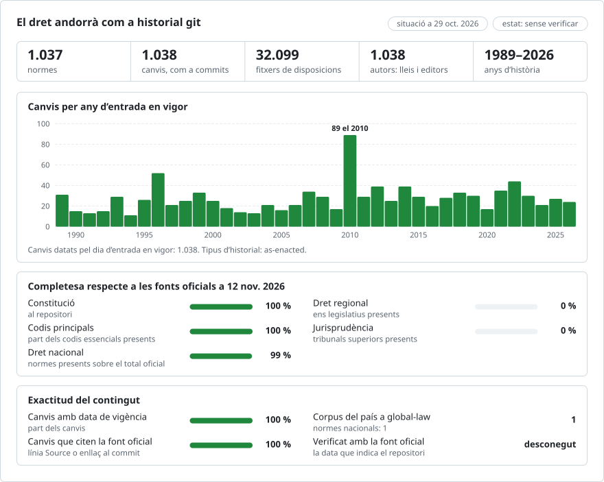

# Les lleis d’Andorra, tal com es van aprovar, com a repositori git

**Català** · [English](README.en.md)

<picture>
<source media="(prefers-color-scheme: dark)" srcset="data/ca/effort-dark.svg">

</picture>

Forma part de [lexifina/global-law](https://github.com/lexifina/global-law), una sola història git per al dret de tots els països: aquest és el dret nacional d’Andorra, que global-law llegeix a `andorra/national/acts/`.

Les lleis del Principat d’Andorra com a repositori git: la Constitució del 1993 i 1.040 lleis del Consell General, del 1989-01-29 al 2026-10-28, cadascuna tal com la va publicar el Butlletí Oficial del Principat d’Andorra (BOPA). Hi ha un fitxer per article, disposició o annex (31.718 fitxers), més el preàmbul i les signatures de cada llei, amb un paràgraf per línia, de manera que `git blame` i `git diff` funcionen línia per línia. El text és en català, la llengua oficial.

**Què és aquest repositori: cada llei tal com es va aprovar, no una història consolidada.** El BOPA publica cada llei una sola vegada, tal com es va aprovar. No publica textos consolidats amb versions anteriors datades; quan Andorra consolida una llei, ho fa aprovant una llei nova («Llei N/AAAA ... del text consolidat de ...»), que figura aquí com a llei per dret propi. Per tant, cada llei és un commit que conté el seu text tal com es va aprovar, datat el dia que va entrar en vigor. **Les modificacions no s’apliquen**: quan una llei posterior modifica un article, el fitxer de la llei anterior continua mostrant aquí el text tal com es va aprovar inicialment. Els canvis que declaren les lleis posteriors («Es modifica l'article 5 de la Llei 3/2010...») es recullen, llei per llei, a [`data/amendments.csv`](data/amendments.csv) (4.048 files). No hi ha cap història línia per línia del text de cap llei ni abans ni després de la seva aprovació.

L’historial conté 1.039 commits a `main` (1.038 lleis, en vigor del 1989-01-29 al 2026-10-29, i un commit de documentació) i 3 lleis a la branca `future`, que entren en vigor després del 2026-10-29.

## Les preguntes d’un advocat com a ordres de git

| Pregunta | Ordre |
| --- | --- |
| Què diu l’article 4 de la llei de drets d’autor del 1999, tal com es va aprovar? | `python tools/in_force_on.py 2026-10-29 lleis/1999-07-06-198be article-004` |
| Tota una llei, en ordre | `python tools/in_force_on.py 2026-10-29 lleis/2022-041` |
| Era en vigor una llei en una data determinada? | `python tools/in_force_on.py 2022-12-15 lleis/2022-041` |
| Quines lleis posteriors declaren que modifiquen la Llei 15/2021? | `grep ',lleis/2021-015,' data/amendments.csv` |
| Què diu una llei sobre la seva pròpia entrada en vigor | `git log -1 --format=%B -- lleis/2022-041` |
| Quines lleis havien entrat en vigor en una data determinada | `git log --format='%(trailers:key=In-force,valueonly,separator=) %s' main` |
| Lleis que encara no són en vigor | `git log main..future --format=%s` |
| La llista de lleis, amb les seves dates | [`laws.csv`](laws.csv) |
| Totes les citacions d’un número d’article | `git grep -E "[Aa]rticles? 25([^0-9]|$)" -- lleis/2022-041` |

Cada llei té la seva pròpia carpeta: `constitucio/` per a la Constitució, `lleis/2022-041/` per a la Llei 41/2022 (l’any i després el número) i, per a les lleis anteriors a l’inici de la numeració (cap al 2000), `lleis/<publication date>-<BOPA document id>/` (data de publicació i identificador del document al BOPA). A dins hi ha: `preamble.md` (el títol, la fórmula d’aprovació, l’exposició de motius i, si n’hi ha, l’índex), un fitxer per article (`article-001.md`, `article-004-bis.md`, `article-unic.md`), un per disposició (`disposicio-final-primera.md`, `disposicio-derogatoria.md`), un per annex i `signatures.md` (el lloc i la data, les signatures i la promulgació dels coprínceps). `index.txt` enumera els fitxers en l’ordre de la llei. Cada fitxer comença amb l’encapçalament de Títol, Capítol o Secció que tingui al damunt, si n’hi ha (`## Capítol segon. ...`), després el seu propi encapçalament (`# Article 4. ...`) i després els seus paràgrafs, un per línia. Les taules tenen una fila per línia, amb les cel·les separades per ` | `.

## Les dates, i quina fem servir

Cada commit de llei està datat el dia que la llei va entrar en vigor, a les dotze del migdia, hora d’Andorra (hora d’Europa central, amb l’horari d’estiu com a la UE), i la data figura al seu trailer `In-force:`. El trailer `In-force-basis:` indica d’on prové la data:

- 957 lleis indiquen quan entren en vigor (`entra en vigor l'endemà de ser publicada`, `al cap de vint dies`, `l'1 de gener del 2023`). La data es compta a partir de la data de publicació al BOPA, que figura al trailer `Published:`. El missatge del commit cita la frase.
- 71 lleis no en diuen res. Es daten segons la regla general del Codi de l’Administració del 29 de març del 1989, article 9 («Llevat que es disposi altrament per llei dels Coprínceps o del Consell General, les normes jurídiques entraran en vigor als quinze dies de llur publicació íntegra»): quinze dies després de la publicació.
- 13 lleis publicades abans d’aquest Codi es daten per la data de publicació.

Quan una llei indica un dia anterior a la seva pròpia data de publicació (per exemple, una llei del pressupost publicada després de l’1 de gener), el commit porta el dia que la llei indica. Una disposició que entra en vigor un dia diferent de la resta de la llei no se separa; porta la data de la seva llei.

`tools/in_force_on.py` respon per a qualsevol data: abans de la data d’entrada en vigor d’una llei, diu que la llei encara no era en vigor; després, imprimeix el text tal com es va aprovar i avisa que les modificacions posteriors no s’apliquen.

## Què vol dir «autor»

Cada commit de llei té com a autor la mateixa llei: `Llei 41/2022 <llei-2022-41@bopa-ad.invalid>` o, per a la Constitució, `Constitució del Principat d'Andorra <constitucio-1993@bopa-ad.invalid>`. Les adreces no poden existir. Qui registra el commit (el *committer*) és Lexifina. No hi ha commits de modificació: una llei modificadora és un commit del seu propi text, a la seva pròpia carpeta, i no se li atribueix cap línia de la llei que modifica.

## Què no mostra

- El text de cap llei tal com ha quedat modificat. Els canvis declarats per lleis posteriors són files de [`data/amendments.csv`](data/amendments.csv), extretes automàticament de frases com «Es modifica l'article 25 del Codi de procediment civil» i «Queda derogada la Llei ...»: la llei modificada tal com l’anomena la llei modificadora (i la seva carpeta aquí, quan se la cita pel número), la disposició, el tipus de canvi (modificació, inserció, derogació, renumeració), la llei modificadora i la seva data d’entrada en vigor, el fitxer on es troba la frase i la frase mateixa. L’extracció no és completa ni s’ha revisat a mà.
- Les correccions d’errates (24 documents). Es recullen a [`data/corrections.csv`](data/corrections.csv) i no s’apliquen.
- Altres normes (decrets, reglaments, actes del Govern) i les normes de les parròquies (comuns).
- Els enllaços que el web del BOPA afegeix a les lleis antigues («Text refós», «Descarrega el document»); no formen part de la llei.
- Les imatges i la maquetació del butlletí.

Els documents que no s’han pogut llegir o situar es recullen a [`data/unreadable.csv`](data/unreadable.csv) (1 fila).

Això és una eina d’ajuda a la recerca, no una publicació oficial. Per a qualsevol qüestió important, consulteu el BOPA. Aquest repositori no l’ha elaborat, patrocinat ni avalat el Servei del Butlletí Oficial del Principat d’Andorra.

## Com es comprova

`tools/build/` conté la construcció tal com es va executar. [`data/source-sha256.tsv`](data/source-sha256.tsv) conté el sha256 de cada document del BOPA que va llegir la construcció, i cada commit indica el seu document (`Source:`, `Source-sha256:`). La construcció és determinista: a partir dels mateixos documents dona els mateixos hashos de commit. Vegeu [`REPRODUCE.md`](REPRODUCE.md). Abans de publicar-la, es va comprovar la construcció en aquests aspectes:
- les lletres i els dígits dels fitxers de cada llei, en ordre, coincideixen amb els del document del BOPA del qual provenen (sense els enllaços afegits pel web), cosa que comprova un script independent que no fa servir l’analitzador de la construcció;
- `tools/in_force_on.py` dona la resposta correcta per a articles de mostra en diverses dates;
- els trailers de tots els commits es poden analitzar; no hi ha fusions (*merges*), ni dates que retrocedeixin, ni dates posteriors a la data de construcció a `main`; cap missatge no conté un retorn de carro;
- dues construccions a partir dels mateixos documents donen el mateix HEAD.

## Com es construeix

La construcció llegeix tots els documents que el BOPA enumera sota els temes «Lleis» i «Constitució», en HTML, del dipòsit de documents del BOPA. A la cerca, els documents llargs apareixen en fragments (`1_<id>.html`, `2_<id>.html`); el document sencer és `<id>.html`, a la mateixa carpeta, i és el que es llegeix. `parse.py` converteix l’HTML en paràgrafs (els documents antics són línies impreses, que es tornen a unir en paràgrafs) i els divideix pels encapçalaments d’article de la mateixa llei; `inforce.py` llegeix la disposició d’entrada en vigor; `build.py` escriu un commit per llei amb `git fast-import`. Cap model d’IA no intervé en la construcció ni en la comprovació.

## Llicència

Font: Butlletí Oficial del Principat d’Andorra, https://www.bopa.ad. Els textos oficials no estan protegits per drets d’autor a Andorra (Llei sobre drets d'autor i drets veïns, del 10 de juny de 1999, article 4(2): «Cap text oficial de naturalesa legislativa, administrativa o judicial, com tampoc cap traducció oficial seva, queden protegits per aquesta Llei.»). L’avís legal del BOPA permet la còpia, la distribució, l’adaptació, l’extracció, la reordenació i la combinació, en qualsevol format, amb les condicions següents, citades tal com es van publicar:

> - Es prohibeix desnaturalitzar el sentit de la informació.
> - Es prohibeix indicar, insinuar o suggerir que Servei del Butlletí Oficial del Principat d'Andorra participa, patrocina o dóna suport a aquesta utilització.
> - Les metadades sobre la data d'actualització i les condicions d'utilització de la informació, si s'inclouen en la informació, s'han de conservar sense alterar-les, i no es poden suprimir.
> - Es prohibeix la utilització de dominis, logotips i elements gràfics que pertanyin al Servei del Butlletí Oficial del Principat d'Andorra, i la seva forma de presentació.

El text de les lleis no s’ha modificat. Les aportacions pròpies de Lexifina (les eines, l’ordenació i els missatges dels commits) són CC0. Vegeu [`LICENSE`](LICENSE) i [`SOURCES.md`](SOURCES.md).

Aquesta és una traducció de la versió anglesa ([README.en.md](README.en.md)); si hi ha diferències, preval la versió anglesa.

## Més informació

Del repositori [lexifina/global-law](https://github.com/lexifina/global-law) (pàgines en anglès):

- [FEATURES.md](https://github.com/lexifina/global-law/blob/main/FEATURES.md): totes les funcions i què ha d’admetre cada corpus (`git blame`, `law.py`, eines MCP)
- [FAQ.md](https://github.com/lexifina/global-law/blob/main/FAQ.md): preguntes i respostes · [CONTRIBUTING.md](https://github.com/lexifina/global-law/blob/main/CONTRIBUTING.md): proposar canvis · [MCP.md](https://github.com/lexifina/global-law/blob/main/MCP.md): servidor MCP · [REPRODUCE.md](https://github.com/lexifina/global-law/blob/main/REPRODUCE.md): com s’ha construït · [CHANGELOG.md](https://github.com/lexifina/global-law/blob/main/CHANGELOG.md)
- [FRESHNESS.md](https://github.com/lexifina/global-law/blob/main/FRESHNESS.md): fins a quin punt està al dia cada corpus · [Supervisió](https://github.com/lexifina/global-law/tree/main/monitoring): si les actualitzacions funcionen · [WATCHING.md](https://github.com/lexifina/global-law/blob/main/WATCHING.md): com es vigila cada font oficial per detectar canvis
- [performance/](https://github.com/lexifina/global-law/tree/main/performance): la rapidesa de les eines, mesurada
- [visualisations/](https://github.com/lexifina/global-law/tree/main/visualisations): gràfics i connexions a través del dret de tot el món
- [Vulnerabilitats](https://github.com/lexifina/global-law/tree/main/vulnerabilities): errors en les normes tal com es van publicar
