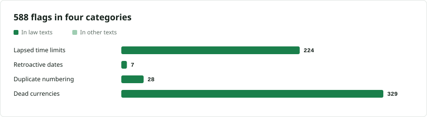

# Vulnerabilities in Andorran law

[Català](README.md) · **English**

<picture>
<source media="(prefers-color-scheme: dark)" srcset="img/flags-by-category-dark.svg">

</picture>

The vulnerability detectors from [lexifina/global-law](https://github.com/lexifina/global-law/tree/main/vulnerabilities) look for mechanical mistakes in legislation: a rule applying "until" a date that has passed, a time limit extended only after it had run out, an amount changed in one place but not in another, a penalty for breaching an article that has been repealed, a rule in force before it was published. global-law's published list (9 November 2026) did not include Andorra, so this is a run over this repository only, as it stood at commit [`60a7ace`](https://github.com/lexifina/andorra-law/commit/60a7ace05529ced7ecf05222d87429c7f227aadf) on 15 November 2026.

**In short:** the detectors raised 588 flags, all in law texts. A language model reviewed 47 of the strongest, arguing each one for and against; 3 survived. Checked by hand in this repository, none is a drafting mistake. Two are lawful: the Civil Service Act of 2000 required the Administration of Justice to adopt its own civil service rules "before 31 December 2002", and the same provision says what applies if it does not; and Law 26/2025 took effect on 1 January 2026, the day it names itself, although the BOPA published it on 14 January, and the offences it rewrites were already in the law it amends. One is spent: the judges and prosecutors appointed under the Justice Act of 1993 were to take their oath "by 25 November 1993". Each law here is its text as enacted, with one commit, and later amendments are listed in [`data/amendments.csv`](../data/amendments.csv) but not applied, so the detectors that compare versions of a text (same-day conflicts, repeal gaps, empty periods, stale amounts, references to deleted provisions, dead fines) had nothing to compare and found nothing. The model does not review duplicate numbering or dead currencies; reading them turned up no mistake in the law: the dead currencies are amounts in pessetes in laws of 1989 to 2001, and the duplicate numbers come almost all from how this repository splits a law into files. That splitting is where the hand check found problems: in at least 17 laws some articles are not in their own file, and in at least 19 the provisions after the last article are in that article's file (see below). Later, this will be formalised in Lean, similar to our work on [the US tax code](https://lexifina.com/blog/formalizing-the-us-tax-code) and [US case law](https://lexifina.com/blog/formalizing-all-us-case-law-in-lean).

A flag is a prompt to look, not legal advice, and nothing here has been tested in court.

## Flags by category

| Category | What it looks for | Flags | In law texts | Reviewed | Survived review |
| --- | --- | ---: | ---: | ---: | ---: |
| Lapsed time limits | Text still applying a rule "until" a date that has passed | 224 | 224 | 40 | 2 |
| Retroactive or pre-publication dates | A rule in force before it was made or published | 7 | 7 | 7 | 1 |
| Duplicate numbering | Two units with the same number in one act | 28 | 28 | 0 | 0 |
| Dead currencies | Amounts in currencies no longer in use | 329 | 329 | 0 | 0 |

"In law texts" counts every file under `lleis/` and `constitucio/`: the Constitution and the laws of the Consell General, with each law's `preamble.md` and `signatures.md`. The repository's own files (`data/`, `tools/`, the READMEs, `laws.csv`) count as not law; no flag is in them. The search for lapsed time limits did not read Catalan: it did not know the month names or "d'agost", "fins al", "fins a l'", nor the deadlines "abans del", "no més tard del", "com a màxim" and "com a molt tard". With them, 2 flags became 224, 98 of them "abans del" (before) a date; it still leaves out 9 phrases that give only a year ("fins a l'any 1992", "abans de l'any 1991", "fins a final de l'any 2003"). The search for dead currencies did not know the Catalan peseta ("pessetes") and took "Sucre" (sugar, in a customs tariff) for the Ecuadorian sucre: 7 flags became 329. Every law has one commit, its text as the BOPA published it, so no provision changes or disappears in this history; that is why the history and reference detectors are not in the table. They do not read `data/amendments.csv`, the 4,048 changes later laws state; a quick comparison of its rows with the files found no amendment of an article that never existed, but did find the repository problems below.

*Edge cases: the 3 flags that survived the review and the 44 that did not, grouped by what they turned out to be, and what the other flags are, in [EDGE-CASES.en.md](EDGE-CASES.en.md).*

## Problems found in this repository

- **Articles that are not in their own file.** The README says each law has one file per article, but in 15 laws the article files do not start at Article 1 and the headings of the missing articles stand in `preamble.md` or in another article's file, and in two more the articles are in the wrong files. In [Law 48/2014](https://github.com/lexifina/andorra-law/blob/60a7ace05529ced7ecf05222d87429c7f227aadf/lleis/2014-048/preamble.md) (the legal profession), Articles 1 to 14 are in `preamble.md` and the files start at `article-015.md`. In [Law 35/2022](https://github.com/lexifina/andorra-law/blob/60a7ace05529ced7ecf05222d87429c7f227aadf/lleis/2022-035/preamble.md), which amends Law 8/2013, the law's own articles are in `preamble.md`, and `article-089.md` to `article-121.md` are Articles 89 to 121 that it adds to Law 8/2013, filed as if they were its own. In [Law 11/2021](https://github.com/lexifina/andorra-law/blob/60a7ace05529ced7ecf05222d87429c7f227aadf/lleis/2021-011/preamble.md), which creates the foundation Andorra Recerca i Innovació, the law's 25 articles, its additional and final provisions and the signatures are in `preamble.md`, and `article-001.md` to `article-038.md` are the foundation's statutes, annexed to it. In [Law 23/2021](https://github.com/lexifina/andorra-law/blob/60a7ace05529ced7ecf05222d87429c7f227aadf/lleis/2021-023/article-003.md) (fees of the higher-education quality agency), headings written with a comma ("Article 4, Obligat al pagament de la taxa") were not read as headings, so Articles 4 to 7 are in `article-003.md`. A file path, `git blame` and global-law's citations name these articles wrongly, and 11 rows of `data/amendments.csv` (9 for Law 48/2014, one each for Laws 23/2021 and 22/2007) amend or repeal an article for which the law's folder has no file. `check_words.py` does not notice, since it compares the letters in order, not where the files split.
- **Provisions after the last article in that article's file.** In at least 19 laws, the additional, transitional, repealing or final provisions, and sometimes the last articles too, are inside the last article's file. [`article-102.md`](https://github.com/lexifina/andorra-law/blob/60a7ace05529ced7ecf05222d87429c7f227aadf/lleis/1993-09-27-7cf6/article-102.md) of the Justice Act of 1993 holds Article 102, Title VIII (the additional provision) and Title IX (ten transitional and two final provisions); `article-050.md` of Law 19/2014 (political parties) holds the transitional provisions; `article-022.md` of Law 4/2025 (the 2025 budget) holds Article 23 and the final provisions. Two of the flags reviewed here, one of them a survivor, sit in such a file.

## Files

| File | What it holds |
| --- | --- |
| [data/flags.csv](data/flags.csv) | Every flag, one row per provision and issue |
| [data/reviewed.csv](data/reviewed.csv) | The 47 flags the model reviewed, with its verdict and reason |
| [data/by_category.csv](data/by_category.csv) | The counts in the table above |
| [tools/](tools/) | The scripts that made this run |

Columns: `category` and `category_ca` (the category in English and Catalan), `detector`, `kind` (`law` or `other`), `path` (the file in this repository), `date` (the date the flag turns on), `reference` (the act or line involved), `summary`, `score` (the detector's ranking, 0 to 1), `review` (`artefact`, `lawful` or `candidate_defect`), `survives_rebuttal`, `review_note` (the model's reason, in English), `url` (the provision at the commit that was read, or, for a retroactive date, the commit of the law).

## How it was made

- **Detectors:** global-law's [vulnerabilities/scripts](https://github.com/lexifina/global-law/tree/main/vulnerabilities/scripts), run on this repository at commit `60a7ace`. The history table the detectors read was built from this repository's own commits (the act that made each change, its `In-force` date and its `Kind`). This repository marks each law `Kind: enacted`, which the first run did not count as law, so the reference detectors read nothing; it now counts as law, and the commit of the documentation and tools (`Kind: documentation`) does not. The detectors carry the fixes global-law's scripts received in the runs on other country repositories, and two for Catalan: the dates and the currency words above.
- **Model review:** gpt-5.4-mini, the 40 strongest flags per category (all 7 retroactive dates), and for lapsed time limits also the 40 strongest in law texts, which are the same 40; one pass says whether a flag is real, a second argues that it is not. There were no empty periods to review. The model does not review duplicate numbering or dead currencies. global-law's own list used a different model.
- **Hand check:** every flag that survived was read in this repository's texts, with the entry-into-force provisions of all seven laws flagged for a retroactive date, Article 63 of the Constitution and, for Law 26/2025, the earlier wording of the article it amends (Law 19/2018). All 28 duplicate numbers were read, and the dead currencies by the words matched. The 77 rows of `data/amendments.csv` that amend or repeal an article for which the amended law's folder has no file were compared with the laws' files, and so were the 24 laws whose article files have gaps.

To report a correction, open an issue with the provision and an official source.

## Licence

The lists and notes are Lexifina's, dedicated to the public domain under CC0 1.0, like the rest of this repository's own contributions. Quoted law text is as the Butlletí Oficial del Principat d'Andorra (BOPA) published it; official texts are not protected by copyright in Andorra (Llei sobre drets d'autor i drets veïns, del 10 de juny de 1999, article 4(2)), and the BOPA's legal notice allows reuse on the conditions quoted in [LICENSE](../LICENSE). This list is not made, sponsored or endorsed by the Servei del Butlletí Oficial del Principat d'Andorra.
