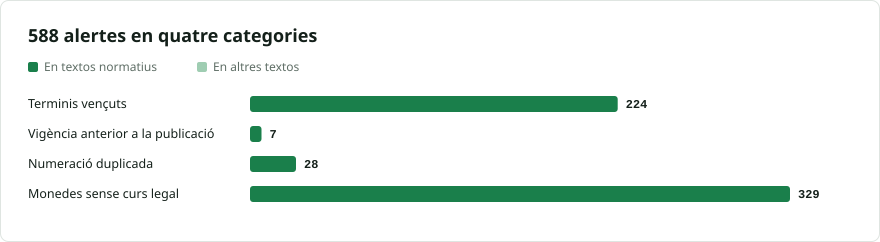

# Vulnerabilitats en el dret andorrà

**Català** · [English](README.en.md)

<picture>
<source media="(prefers-color-scheme: dark)" srcset="img/flags-by-category-dark.ca.svg">

</picture>

Els detectors de vulnerabilitats de [lexifina/global-law](https://github.com/lexifina/global-law/tree/main/vulnerabilities) cerquen errors mecànics en la legislació: una regla que continua aplicant-se «fins a» una data ja passada, un termini prorrogat quan ja havia vençut, un import modificat en un lloc però no en un altre, una sanció per infringir un article derogat, una norma en vigor abans de ser publicada. La llista que global-law va publicar el 9 de novembre del 2026 no incloïa Andorra; aquesta és, doncs, una revisió d’aquest repositori sol, en l’estat del commit [`60a7ace`](https://github.com/lexifina/andorra-law/commit/60a7ace05529ced7ecf05222d87429c7f227aadf) del 15 de novembre del 2026.

**En resum:** els detectors van generar 588 alertes, totes en textos normatius. Un model de llenguatge en va revisar les 47 més sòlides, amb arguments a favor i en contra de cadascuna; 3 van resistir. Comprovades a mà en aquest repositori, cap no és un error de redacció. Dues són conformes a dret: la Llei de la funció pública del 2000 obligava l’Administració de justícia a aprovar la normativa de la seva funció pública pròpia «abans del 31 de desembre del 2002», i la mateixa disposició preveu què s’aplica si no ho fa; i la Llei 26/2025 va entrar en vigor l’1 de gener del 2026, el dia que ella mateixa fixa, tot i que el BOPA la va publicar el 14 de gener, i les infraccions que redacta de nou ja eren a la llei que modifica. Una és una regla exhaurida: els jutges i fiscals nomenats en aplicació de la Llei qualificada de la Justícia del 1993 havien de prestar jurament «per tot el dia 25 de novembre de 1993». Cada llei és aquí el seu text tal com es va aprovar, amb un sol commit, i les modificacions posteriors es recullen a [`data/amendments.csv`](../data/amendments.csv) però no s’hi apliquen; per això els detectors que comparen versions d’un text (modificacions del mateix dia, llacunes després de la derogació, períodes de buit normatiu, imports no actualitzats, remissions a preceptes inexistents, sancions sense infracció) no tenien res a comparar i no van trobar res. El model no revisa la numeració duplicada ni les monedes sense curs legal; la lectura d’aquestes alertes no ha revelat cap error en el dret: les monedes són imports en pessetes de lleis del 1989 al 2001, i els números duplicats provenen gairebé tots de la manera com aquest repositori divideix les lleis en fitxers. És en aquesta divisió on la comprovació manual ha trobat problemes: en almenys 17 lleis hi ha articles que no són al seu propi fitxer, i en almenys 19 les disposicions posteriors a l’últim article són dins el fitxer d’aquest article (vegeu més avall). Més endavant es formalitzarà en Lean, com el nostre treball sobre [el codi tributari dels EUA](https://lexifina.com/blog/formalizing-the-us-tax-code) i [la jurisprudència dels EUA](https://lexifina.com/blog/formalizing-all-us-case-law-in-lean).

Una alerta és una invitació a examinar el text, no un assessorament jurídic, i res del que s’exposa aquí no s’ha sotmès a cap tribunal.

## Alertes per categoria

| Categoria | Què busca | Alertes | En textos normatius | Revisades | Han resistit la revisió |
| --- | --- | ---: | ---: | ---: | ---: |
| Terminis vençuts | Un text que continua aplicant una regla «fins a» una data ja passada | 224 | 224 | 40 | 2 |
| Vigència anterior a la publicació | Una norma en vigor abans de ser aprovada o publicada | 7 | 7 | 7 | 1 |
| Numeració duplicada | Dues divisions amb el mateix número en una mateixa norma | 28 | 28 | 0 | 0 |
| Monedes sense curs legal | Imports en monedes que ja no s’utilitzen | 329 | 329 | 0 | 0 |

«En textos normatius» compta tots els fitxers de `lleis/` i `constitucio/`: la Constitució i les lleis del Consell General, amb el `preamble.md` i el `signatures.md` de cada llei. Els fitxers propis del repositori (`data/`, `tools/`, els README, `laws.csv`) no compten com a textos normatius; no hi ha cap alerta. La cerca de terminis vençuts no llegia el català: no coneixia els noms dels mesos ni «d’agost», «fins al», «fins a l’», ni els terminis màxims «abans del», «no més tard del», «com a màxim» i «com a molt tard». Amb aquestes formes, les 2 alertes van passar a 224, 98 de les quals són «abans del» una data; encara deixa fora 9 expressions que només indiquen un any («fins a l’any 1992», «abans de l’any 1991», «fins a final de l’any 2003»). La cerca de monedes sense curs legal no coneixia la pesseta en català («pessetes») i prenia «Sucre» (el producte, en un aranzel duaner) pel sucre equatorià: les 7 alertes van passar a 329. Cada llei té un sol commit, el seu text tal com el va publicar el BOPA, de manera que en aquesta història cap disposició no canvia ni desapareix; per això els detectors d’història i de remissions no apareixen a la taula. Aquests detectors no llegeixen `data/amendments.csv`, els 4.048 canvis que declaren les lleis posteriors; una comparació ràpida de les seves files amb els fitxers no ha trobat cap modificació d’un article que no hagi existit mai, però sí els problemes del repositori que s’exposen més avall.

*Casos límit: les 3 alertes que van resistir la revisió i les 44 que no, agrupades segons el que van resultar ser, i què són les altres alertes, a [EDGE-CASES.md](EDGE-CASES.md).*

## Problemes detectats en aquest repositori

- **Articles que no són al seu propi fitxer.** El README diu que cada llei té un fitxer per article, però en 15 lleis els fitxers d’articles no comencen per l’article 1 i els encapçalaments dels articles que falten són al `preamble.md` o al fitxer d’un altre article, i en dues més els articles són en fitxers equivocats. En la [Llei 48/2014](https://github.com/lexifina/andorra-law/blob/60a7ace05529ced7ecf05222d87429c7f227aadf/lleis/2014-048/preamble.md), de l’exercici de la professió d’advocat, els articles 1 a 14 són al `preamble.md` i els fitxers comencen a `article-015.md`. En la [Llei 35/2022](https://github.com/lexifina/andorra-law/blob/60a7ace05529ced7ecf05222d87429c7f227aadf/lleis/2022-035/preamble.md), que modifica la Llei 8/2013, els articles de la llei mateixa són al `preamble.md`, i `article-089.md` a `article-121.md` són els articles 89 a 121 que afegeix a la Llei 8/2013, desats com si fossin seus. En la [Llei 11/2021](https://github.com/lexifina/andorra-law/blob/60a7ace05529ced7ecf05222d87429c7f227aadf/lleis/2021-011/preamble.md), de creació de la Fundació Privada del Sector Públic Andorra Recerca i Innovació, els 25 articles de la llei, les seves disposicions addicionals i final i les signatures són al `preamble.md`, i `article-001.md` a `article-038.md` són els estatuts de la fundació, que s’hi annexen. En la [Llei 23/2021](https://github.com/lexifina/andorra-law/blob/60a7ace05529ced7ecf05222d87429c7f227aadf/lleis/2021-023/article-003.md), de taxes de l’Agència de Qualitat de l’Ensenyament Superior, els encapçalaments escrits amb una coma («Article 4, Obligat al pagament de la taxa») no es van llegir com a encapçalaments, de manera que els articles 4 a 7 són a `article-003.md`. La ruta del fitxer, `git blame` i les citacions de global-law designen malament aquests articles, i 11 files de `data/amendments.csv` (9 de la Llei 48/2014 i una de les lleis 23/2021 i 22/2007) modifiquen o deroguen un article que no té fitxer a la carpeta de la llei. `check_words.py` no ho detecta, perquè compara les lletres en ordre, no on es divideixen els fitxers.
- **Disposicions posteriors a l’últim article dins el fitxer d’aquest article.** En almenys 19 lleis, les disposicions addicionals, transitòries, derogatòries o finals, i de vegades també els últims articles, són dins el fitxer de l’últim article. El fitxer [`article-102.md`](https://github.com/lexifina/andorra-law/blob/60a7ace05529ced7ecf05222d87429c7f227aadf/lleis/1993-09-27-7cf6/article-102.md) de la Llei qualificada de la Justícia del 1993 conté l’article 102, el títol VIII (la disposició addicional) i el títol IX (deu disposicions transitòries i dues de finals); `article-050.md` de la Llei 19/2014, qualificada de partits polítics i finançament electoral, conté les disposicions transitòries; `article-022.md` de la Llei 4/2025, del pressupost per a l’exercici del 2025, conté l’article 23 i les disposicions finals. Dues de les alertes revisades, una de les quals ha resistit la revisió, són en un fitxer d’aquest tipus.

## Fitxers

| Fitxer | Contingut |
| --- | --- |
| [data/flags.csv](data/flags.csv) | Totes les alertes, una fila per precepte i problema |
| [data/reviewed.csv](data/reviewed.csv) | Les 47 alertes que va revisar el model, amb el seu veredicte i el seu motiu |
| [data/by_category.csv](data/by_category.csv) | Les xifres de la taula anterior |
| [tools/](tools/) | Els scripts d’aquesta revisió |

Columnes: `category` i `category_ca` (la categoria en anglès i en català), `detector`, `kind` (`law` o `other`), `path` (el fitxer en aquest repositori), `date` (la data de la qual depèn l’alerta), `reference` (la llei o la línia afectada), `summary`, `score` (la puntuació del detector, de 0 a 1), `review` (`artefact`, `lawful` o `candidate_defect`), `survives_rebuttal`, `review_note` (el motiu del model, en anglès), `url` (el precepte en el commit llegit o, en la vigència anterior a la publicació, el commit de la llei).

## Com s’ha fet

- **Detectors:** els [vulnerabilities/scripts](https://github.com/lexifina/global-law/tree/main/vulnerabilities/scripts) de global-law, executats sobre aquest repositori en el commit `60a7ace`. La taula d’història que llegeixen els detectors es va construir amb els commits d’aquest repositori (la llei que va fer cada canvi, la seva data `In-force` i el seu `Kind`). Aquest repositori marca cada llei amb `Kind: enacted`, que la primera execució no comptava com a dret, de manera que els detectors de remissions no van llegir res; ara compta com a dret, i el commit de la documentació i les eines (`Kind: documentation`) no. Els detectors incorporen les correccions que els scripts de global-law van rebre en les revisions d’altres repositoris nacionals, i dues per al català: les dates i les paraules de moneda indicades més amunt.
- **Revisió pel model:** gpt-5.4-mini, les 40 alertes més sòlides de cada categoria (les 7 de vigència anterior a la publicació) i, en els terminis vençuts, també les 40 més sòlides en textos normatius, que són les mateixes 40; una passada diu si l’alerta és real i una altra argumenta que no ho és. No hi havia períodes de buit normatiu per revisar. El model no revisa la numeració duplicada ni les monedes sense curs legal. La llista pròpia de global-law va fer servir un altre model.
- **Comprovació manual:** cada alerta que va resistir es va llegir en els textos d’aquest repositori, amb les disposicions d’entrada en vigor de les set lleis assenyalades per vigència anterior a la publicació, l’article 63 de la Constitució i, per a la Llei 26/2025, la redacció anterior de l’article que modifica (Llei 19/2018). Es van llegir els 28 números duplicats i, per les paraules trobades, les monedes sense curs legal. Les 77 files de `data/amendments.csv` que modifiquen o deroguen un article sense fitxer a la carpeta de la llei modificada es van comparar amb els fitxers de les lleis, igual que les 24 lleis amb llacunes en la numeració dels fitxers d’articles.

Per comunicar una correcció, obriu una incidència amb el precepte i una font oficial.

## Llicència

Les llistes i les notes són de Lexifina i se cedeixen al domini públic amb CC0 1.0, com la resta de les aportacions pròpies d’aquest repositori. El text jurídic citat és el que va publicar el Butlletí Oficial del Principat d’Andorra (BOPA); els textos oficials no estan protegits per drets d’autor a Andorra (Llei sobre drets d’autor i drets veïns, del 10 de juny de 1999, article 4(2)), i l’avís legal del BOPA en permet la reutilització amb les condicions citades a [LICENSE](../LICENSE). Aquesta llista no l’ha elaborat, patrocinat ni avalat el Servei del Butlletí Oficial del Principat d’Andorra.
